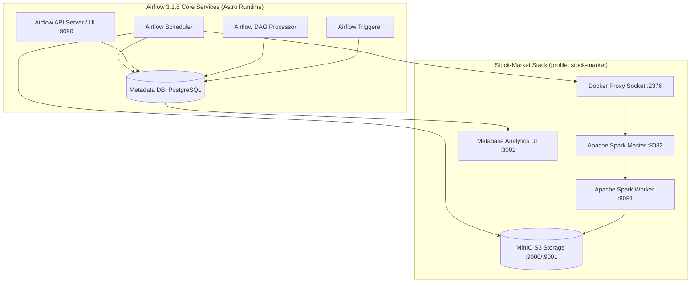
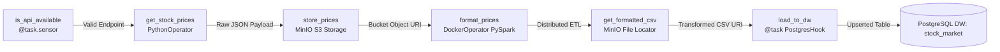

# System Architecture & Pipeline Design

This document details the engineering design, component topology, and data flows of the Apache Airflow pipelines in this repository.

---

## 1. High-Level Component Topology

The repository provides two containerized local topologies:

1. **Primary Portfolio Stack (Root — Astro Runtime / Apache Airflow 3.1.8)**: Runs core Airflow services (`api-server`, `dag-processor`, `scheduler`, `triggerer`, `postgres`) with an optional `stock-market` Compose profile for MinIO, Spark, Docker Proxy, and Metabase.
2. **Distributed Celery Reference Stack (`infra/celery/` — Apache Airflow 2.10.5)**: Runs Redis, PostgreSQL, Airflow Webserver/Scheduler/Triggerer, Flower monitoring, and specialized `cpu` and `gpu` Celery worker services.

> **Note**: Heavy analytics services (`minio`, `spark-master`, `spark-worker`, `metabase`, `docker-proxy`) are scoped under the Docker Compose `stock-market` profile in [`docker-compose.override.yml`](../docker-compose.override.yml) so baseline `astro dev start` stays lightweight and responsive.

---

## 2. Pipeline 1: Stock Market Data Lakehouse (`dags/stock_market.py`)

An end-to-end financial data pipeline that probes market API availability, stages raw JSON payloads in object storage, runs distributed transformations in Spark, and loads analytics rows into PostgreSQL.

### Stage Details

1. **`is_api_available` (`@task.sensor`)**: Uses `PokeReturnValue` to probe the Yahoo Finance endpoint (`BaseHook.get_connection("stock_api")` with public fallback) before downstream execution.
2. **`get_stock_prices` (`PythonOperator`)**: Pulls 1-year daily OHLCV history for `NVDA` via [`include/stock_market/tasks.py`](../include/stock_market/tasks.py).
3. **`store_prices` (`PythonOperator`)**: Creates the `stock-market` bucket if missing and writes immutable raw JSON (`NVDA/prices.json`) into MinIO.
4. **`format_prices` (`DockerOperator` + PySpark)**: Launches an ephemeral `airflow/stock-app` container running [`spark/notebooks/stock_transform/stock_transform.py`](../spark/notebooks/stock_transform/stock_transform.py) attached to `spark-master` to flatten nested JSON arrays and write CSV partitions back to MinIO.
5. **`get_formatted_csv` (`PythonOperator`)**: Locates the generated `.csv` output object under `<SYMBOL>/formatted_prices/` in MinIO.
6. **`load_to_dw` (`@task`)**: Streams the CSV directly from MinIO and performs idempotent `ON CONFLICT (timestamp) DO UPDATE` upserts into `stock_market` in PostgreSQL (`postgres` connection).

---

## 3. Pipeline 2: Event-Driven Cocktail ETL (`dags/extractor.py`, `dags/cocktail_loader.py`, `dags/ecom.py`)

A multi-DAG pipeline demonstrating Airflow 3 **Asset-driven scheduling**, TaskGroups, runtime branching, lifecycle callbacks, and custom trigger rules.

### Key Engineering Features

- **Asset-Driven Scheduling**: `cocktail_loader` and `ecom` trigger automatically whenever `Dataset_cocktail` ([`include/datasets.py`](../include/datasets.py)) is updated by `extractor`.
- **Safe Configuration Lookup**: `include/tasks.py` reads `COCKTAIL_API` from environment variables at task execution time (with `DEFAULT_API` fallback), while `dags/extractor.py` passes `{{ var.value.get('api', ...) }}` via Jinja `templates_dict` — avoiding module-scope DB calls.
- **Dynamic Branching & Trigger Rules**: `branch_cocktail_type` inspects the extracted payload at runtime and routes to `alcoholic_drink` or `non_alcoholic_drink`; `clean_data` uses `TriggerRule.NONE_FAILED_MIN_ONE_SUCCESS` and retains `/tmp/cocktail.json` so downstream Asset consumers never hit a file race condition.
- **Transactional Postgres Upserts**: `cocktail_loader` (`cocktail_db` connection) creates the `cocktails` table if needed and guarantees idempotence via `ON CONFLICT (drink_id) DO UPDATE`.

---

## 4. Pipeline 3: Celery Parallelism & Multi-Queue Routing

Two complementary DAGs cover distributed execution:

- **[`dags/celery_parallelism_demo.py`](../dags/celery_parallelism_demo.py)** *(Airflow 3.1.8 SDK)*: Fans out `prepare_batch` across `worker_alpha`, `worker_beta`, and `worker_gamma` before converging at `aggregate_results`.
- **[`infra/celery/dags/celery.py`](../infra/celery/dags/celery.py)** *(Airflow 2.10.5 Compose stack)*: Routes task `b` to `queue="gpu"` (`airflow-worker`) and tasks `a`, `c`, `d` to `queue="cpu"` (`airflow-worker-2`). See [Executors & Scaling Guide](executors_guide.md) and [Celery DAG Pattern Guide](celery_dag_pattern.md).
