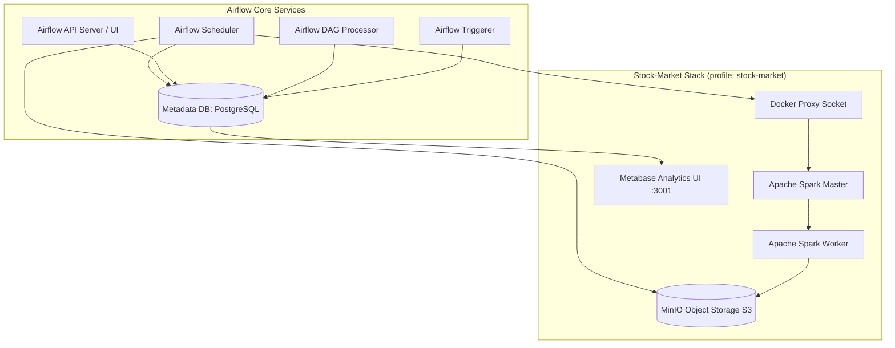
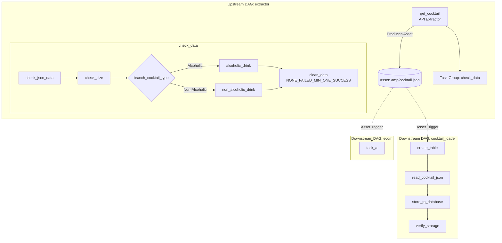

# System Architecture & Pipeline Design

This document details the engineering design, component topology, and data flows of the Apache Airflow pipelines in this repository.

---

## 1. High-Level Component Topology

The local development and testing environment runs via containerized services orchestrated by Docker Compose and Astro Runtime (`Apache Airflow 3.1.8`):

> **Note**: Heavy analytics services (`minio`, `spark-master`, `spark-worker`, `metabase`, `docker-proxy`) are scoped under the Docker Compose `stock-market` profile so baseline `astro dev start` stays lightweight and responsive.

---

## 2. Pipeline 1: Stock Market Data Lakehouse (`dags/stock_market.py`)

An end-to-end financial data pipeline that probes market API availability, stages raw JSON payloads in object storage, runs distributed transformations in Spark, and loads analytics rows into PostgreSQL.

```mermaid
flowchart LR
    A[is_api_available<br/>TaskFlow Sensor] -->|Valid Endpoint| B[get_stock_prices<br/>PythonOperator]
    B -->|Raw JSON Payload| C[store_prices<br/>MinIO S3 Storage]
    C -->|Bucket Object URI| D[format_prices<br/>DockerOperator PySpark]
    D -->|Distributed ETL| E[get_formatted_csv<br/>MinIO File Locator]
    E -->|Transformed CSV URI| F[load_to_dw<br/>Airflow 3 TaskFlow Loader]
    F -->|Upserted Table| G[(PostgreSQL Warehouse)]
```

### Stage Details

1. **`is_api_available` (`@task.sensor`)**: Uses `PokeReturnValue` to probe external API readiness before downstream execution.
2. **`get_stock_prices` (`PythonOperator`)**: Pulls 1-year daily OHLCV history for `NVDA`.
3. **`store_prices` (`PythonOperator`)**: Writes immutable raw JSON into MinIO bucket `stock-market`.
4. **`format_prices` (`DockerOperator` + PySpark)**: Launches an ephemeral PySpark container against `spark-master` to flatten nested arrays and write CSV partitions back to MinIO.
5. **`get_formatted_csv` (`PythonOperator`)**: Locates the generated `.csv` output object in MinIO.
6. **`load_to_dw` (`@task`)**: Streams the CSV directly from MinIO and performs idempotent `ON CONFLICT` upserts into `public.stock_market` in PostgreSQL.

---

## 3. Pipeline 2: Event-Driven Cocktail ETL (`dags/extractor.py`, `dags/cocktail_loader.py`, `dags/ecom.py`)

A modern multi-DAG pipeline demonstrating Asset/Dataset-driven scheduling, TaskGroups, runtime branching, and custom trigger rules.

### Key Engineering Features

- **Asset-Driven Scheduling**: `cocktail_loader` and `ecom` trigger automatically whenever `Dataset_cocktail` is updated by `extractor`.
- **Dynamic Branching**: Inspects extracted JSON at runtime to select downstream execution paths cleanly.
- **Trigger Rules**: `TriggerRule.NONE_FAILED_MIN_ONE_SUCCESS` ensures final verification runs regardless of branch outcome.
- **Transactional Postgres Upserts**: `cocktail_loader` guarantees idempotence via `ON CONFLICT (drink_id) DO UPDATE`.
