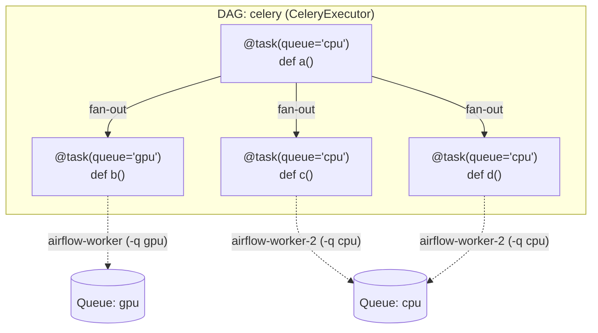

# Celery DAG Pattern — Learning Guide

## Overview

This guide documents the `@dag` / `@task` decorator pattern and queue-based routing used in [`infra/celery/dags/celery.py`](../infra/celery/dags/celery.py), including the syntax fix for `@dag` / `@task` placement and how tasks route to specialized `cpu` and `gpu` Celery workers.

> **Airflow Version Note**: Root DAGs under [`dags/`](../dags/) run on **Apache Airflow 3.1.8** and import decorators from `airflow.sdk`. The standalone Celery Compose stack under [`infra/celery/`](../infra/celery/) uses `apache/airflow:2.10.5`, so `infra/celery/dags/celery.py` uses `from airflow.decorators import dag, task`.

---

## Key Concepts

### 1. `@dag` Decorator

- Applied directly above the DAG factory function (`def celery():`).
- Configures DAG-level metadata (`start_date`, `schedule`, `catchup`, `default_args`, `tags`, `description`).
- Must always be on its own line above `def <dag_name>():`.

### 2. `@task` Decorator & Queue Routing

- Applied to individual task functions **inside** the DAG function.
- `executor` is **not** passed on the DAG signature line; when `AIRFLOW__CORE__EXECUTOR=CeleryExecutor` is active, tasks execute on Celery workers automatically.
- Use `queue="<queue_name>"` on `@task(...)` to route specialized workloads to dedicated workers (`-q cpu`, `-q gpu`).

### 3. Decorator Syntax Mistake (Fixed)

**Before (INCORRECT):**

```python
@dag(start_date=datetime(2025, 1, 1), schedule=None, catchup=False)
def celery():@task(executor="celery")  # Syntax error: decorator on same line as def
```

**After (CORRECT):**

```python
@dag(start_date=datetime(2025, 1, 1), schedule=None, catchup=False)
def celery():
    @task(queue="cpu")
    def a():
        ...
```

See the standalone before/after diagram source: [`diagrams/celery_decorator_fix.mmd`](diagrams/celery_decorator_fix.mmd).

---

## Current Implementation (`infra/celery/dags/celery.py`)

```python
from datetime import timedelta
from time import sleep

from airflow.decorators import dag, task
from pendulum import datetime


@dag(
    start_date=datetime(2025, 1, 1),
    schedule=None,
    catchup=False,
    default_args={
        "retries": 2,
        "retry_delay": timedelta(seconds=5),
    },
    tags=["executors", "celery", "queues", "demo"],
    description="Demonstrates multi-queue Celery task routing across cpu and gpu workers",
)
def celery():
    @task(queue="cpu")
    def a() -> None:
        print("A")
        sleep(15)

    @task(queue="gpu")
    def b() -> None:
        print("B")
        sleep(15)

    @task(queue="cpu")
    def c() -> None:
        print("C")
        sleep(15)

    @task(queue="cpu")
    def d() -> None:
        print("D")
        sleep(15)

    a() >> [b(), c(), d()]


celery()
```

---

## Diagram: DAG Task Flow & Queue Routing



Standalone Mermaid source: [`diagrams/celery_dag_flow.mmd`](diagrams/celery_dag_flow.mmd).

---

## Execution Flow

1. **DAG Definition**: `@dag` registers the `celery` DAG with manual trigger (`schedule=None`), `catchup=False`, and `retries=2`.
2. **Task Registration & Routing**: Each `@task(queue=...)` registers an Airflow task targeting either the `cpu` or `gpu` Celery queue.
3. **Dependency Graph**: `a() >> [b(), c(), d()]` runs `a` first on `airflow-worker-2` (`cpu` queue), then dispatches `b` (`gpu` queue) and `c`, `d` (`cpu` queue) in parallel.
4. **Worker Consumption**: `airflow-worker` (`celery worker -q gpu`) executes `b`, while `airflow-worker-2` (`celery worker -q cpu`) executes `a`, `c`, and `d`.

---

## Best Practices

| Do | Don't |
|---|---|
| Put `@dag` on its own line above `def` | Chain decorators on the same line as `def` |
| Place `@task` decorators on functions **inside** the DAG | Pass `@task(executor="...")` onto the DAG function |
| Route heavy/specialized tasks via `@task(queue="...")` | Overload a single default queue for heterogeneous workloads |
| Follow PEP 8 formatting (`sleep(15)`, 2-space blank lines) | Mix inconsistent whitespace around function calls |
| Instantiate the DAG at module bottom (`celery()`) | Forget to call the `@dag`-decorated function |

---

## Troubleshooting

**Error**: `[Pyrefly Error] Parse error: Expected class, function definition or async function definition after decorator`

**Cause**: Decorator placed inline after `def celery():` on the same line.

**Fix**: Separate `@dag(...)`, `def celery():`, and nested `@task(...)` onto dedicated lines with proper 4-space indentation.
